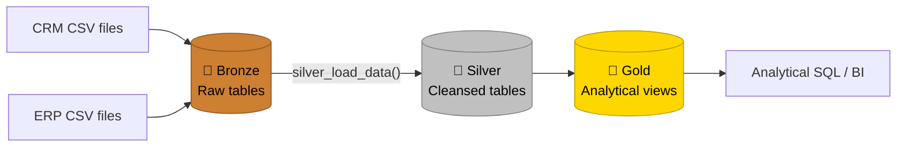
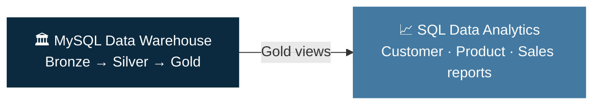

<div align="center">


### 🏛️ From raw CRM and ERP files to analytics-ready views


[](https://www.linkedin.com/in/gist-widdan-anasis-3a0a5b39a/)
[](https://github.com/widdangist999)

</div>

---

## 📑 Table of Contents

- [Project Overview](#-project-overview)
- [Data Warehouse Architecture](#-data-warehouse-architecture)
- [Data Sources](#-data-sources)
- [Data Processing Workflow](#-data-processing-workflow)
- [Data Quality Checks](#-data-quality-checks)
- [Technology Stack](#-technology-stack)
- [Repository Structure](#-repository-structure)
- [How to Use](#-how-to-use)
- [Downstream Project: SQL Data Analytics](#-downstream-project-sql-data-analytics)
- [Limitations and Future Improvements](#-limitations-and-future-improvements)
- [Connect](#-connect)

---

## 🎯 Project Overview

This project demonstrates the development of a data warehouse using **MySQL 8.0** and SQL. It integrates data from **Customer Relationship Management (CRM)** and **Enterprise Resource Planning (ERP)** systems, processes the raw data through a **Bronze–Silver–Gold** architecture, and prepares analytics-ready views for business analysis.

**The project focuses on:**

| 📥 Ingestion | 🧹 Cleansing | 📐 Standardization | 🔄 Transformation |
|:---:|:---:|:---:|:---:|
| Loading raw files | Fixing messy data | Consistent formats | Business-ready logic |

| 🔗 Integration | ✅ Quality Checks | 🧱 Data Modeling |
|:---:|:---:|:---:|
| Joining CRM and ERP | Validating results | Analytical views |

---

## 🏗️ Data Warehouse Architecture

The data warehouse follows a **three-layer architecture**:

<p align="center">
  
</p>



### Architecture Overview

| Layer | Object Type | Description |
|:---:|:---:|---|
| 🥉 **Bronze** | Tables | Stores raw data loaded from CRM and ERP CSV files. |
| 🥈 **Silver** | Tables | Cleans, standardizes, validates, and transforms the raw data. |
| 🥇 **Gold** | Views | Provides integrated, business-ready data for analytical queries. |

---

## 📂 Data Sources

The project uses **six CSV files** from CRM and ERP source systems.

### CRM Sources

| File | Description |
|---|---|
| `cust_info.csv` | Customer information, including customer identifiers and demographic attributes. |
| `prd_info.csv` | Product information, including product identifiers, names, costs, and product lines. |
| `sales_details.csv` | Sales transaction details, including order dates, products, quantities, and sales amounts. |

### ERP Sources

| File | Description |
|---|---|
| `CUST_AZ12.csv` | Additional customer attributes, including birth dates and gender. |
| `LOC_A101.csv` | Customer location and country information. |
| `PX_CAT_G1V2.csv` | Product category, subcategory, and maintenance information. |

---

## ⚙️ Data Processing Workflow

### 🥉 1. Bronze Layer: Raw Data

The Bronze layer stores source data in MySQL tables using a structure close to the original CSV files.

**Key activities**
- Load source data from CRM and ERP CSV files.
- Preserve the original source structure as much as practical.
- Support batch-based data loading and reloading.

### 🥈 2. Silver Layer: Cleansed and Standardized Data

The Silver layer applies SQL transformations to improve data consistency and usability.

**Key activities**
- Remove duplicate customer records.
- Clean text values and standardize customer attributes.
- Normalize customer and product identifiers for integration.
- Handle missing, invalid, and inconsistent values.
- Convert date fields into appropriate date formats.
- Derive product validity end dates.
- Validate and correct sales amounts and prices where applicable.
- Standardize country and demographic values.

> 🔁 The `silver_load_data()` stored procedure refreshes the Silver tables from the Bronze layer.

### 🥇 3. Gold Layer: Analytics-Ready Views

The Gold layer consists of SQL views that integrate the cleaned data into business-oriented structures.

| View | Description |
|---|---|
| `gold_dim_customers` | Customer dimension containing customer details, location, demographic information, and account creation date. |
| `gold_dim_products` | Product dimension containing product details, category, subcategory, cost, product line, and start date. |
| `gold_fact_sales` | Sales fact view connecting transaction records with customer and product dimensions. |

These views support analytical SQL queries without requiring a separate data-loading process into Gold tables.

---

## ✅ Data Quality Checks

SQL scripts are provided to examine data quality across the Bronze and Silver layers.

**The checks cover:**
- 🔑 Missing and duplicate identifiers
- 🔤 Inconsistent text formatting
- 📅 Invalid or missing dates
- 💲 Negative or missing product costs
- 🧮 Sales amount and price consistency
- 🏷️ Unexpected categorical values
- 📊 Row counts across the data warehouse layers

These checks help identify potential data issues and validate transformation logic. Actual results depend on the source data and the execution of the scripts.

---

## 🛠️ Technology Stack

| Component | Technology |
|---|---|
| **Database** | MySQL 8.0 |
| **Query Language** | SQL |
| **Data Sources** | CRM and ERP CSV files |
| **Data Modeling** | Bronze–Silver–Gold architecture |
| **Data Transformation** | SQL queries and stored procedures |
| **Analytical Layer** | SQL views |

---

## 📁 Repository Structure

```text
sql_data_warehouse_project/
├── datasets/
│   ├── source_crm/
│   └── source_erp/
├── scripts/
│   ├── bronze/
│   ├── silver/
│   └── gold/
├── tests/
├── docs/
└── README.md
```

> **Note:** The structure above is illustrative. Adjust the folder names to match the actual repository structure.

---

## 🚀 How to Use

1. Install and configure **MySQL 8.0**.
2. Clone or download this repository.
3. Place the source CSV files in the appropriate folders.
4. Execute the **Bronze** layer scripts to create and load the raw tables.
5. Execute the **Silver** layer scripts and run `silver_load_data()` to process the data.
6. Create the **Gold** views using the provided SQL scripts.
7. Run the data quality checks and analytical queries.

> ⚠️ Review the SQL scripts and update any file paths to match your local MySQL configuration before executing them.

---

## 🔗 Downstream Project: SQL Data Analytics

This Data Warehouse project serves as the **foundation** for a separate SQL-based data analytics project.

After integrating, cleaning, and transforming raw CRM and ERP data through the Bronze, Silver, and Gold layers, the resulting Gold views provide structured and analytics-ready datasets for further business analysis.

The downstream project uses MySQL to explore the prepared data and generate business-oriented analytical reports.

<div align="center">

[](https://github.com/widdangist999/sql_data_analiytics_project)

</div>

### Relationship Between the Projects

| Project | Main Focus | Key Outputs |
|---|---|---|
| 🏛️ **MySQL Data Warehouse** | Data engineering and preparation | Cleaned tables, integrated datasets, and Gold analytical views |
| 📈 **SQL Data Analytics** | Business analysis and reporting | Customer, product, and sales analytical reports |



### Analytical Areas

The SQL Data Analytics project focuses on three main areas:

- 👥 **Customer Analysis:** Examines customer profiles, purchasing behavior, and customer segmentation.
- 📦 **Product Analysis:** Evaluates product performance, revenue contribution, and sales distribution.
- 💰 **Sales Analysis:** Analyzes overall sales performance, transaction patterns, and key business metrics.

### End-to-End Project Workflow

The relationship between the two projects represents an end-to-end data workflow:

1. **Data Ingestion:** Load raw CRM and ERP datasets into the Bronze layer.
2. **Data Transformation:** Clean, standardize, and integrate data in the Silver layer.
3. **Data Modeling:** Build analytical views in the Gold layer.
4. **Data Analysis:** Use the Gold views as the foundation for analytical SQL queries.
5. **Business Reporting:** Generate customer, product, and sales reports to support data-driven insights.

> By separating data warehouse development from analytical reporting, these projects demonstrate two complementary stages of working with data: **preparing reliable datasets** and **transforming them into meaningful business information**.

---

## 🔭 Limitations and Future Improvements

- The current workflow uses **full refreshes** for the Silver layer rather than incremental loading.
- Gold surrogate keys generated using `ROW_NUMBER()` may change when the underlying data or ordering changes.
- Data integration depends on **consistent identifiers** across CRM and ERP sources.
- Automated orchestration, logging, and error handling could be added to improve operational reliability.
- The Gold views can be connected to a **BI tool** for further visualization and reporting.

---

## 🤝 Connect

- 💼 **LinkedIn:** [Gist Widdan Anasis](https://www.linkedin.com/in/gist-widdan-anasis-3a0a5b39a/)
- 🐙 **GitHub:** [widdangist999](https://github.com/widdangist999)

<div align="center">

⭐ *If you find this project useful, a star on the repository is appreciated!*


</div>
