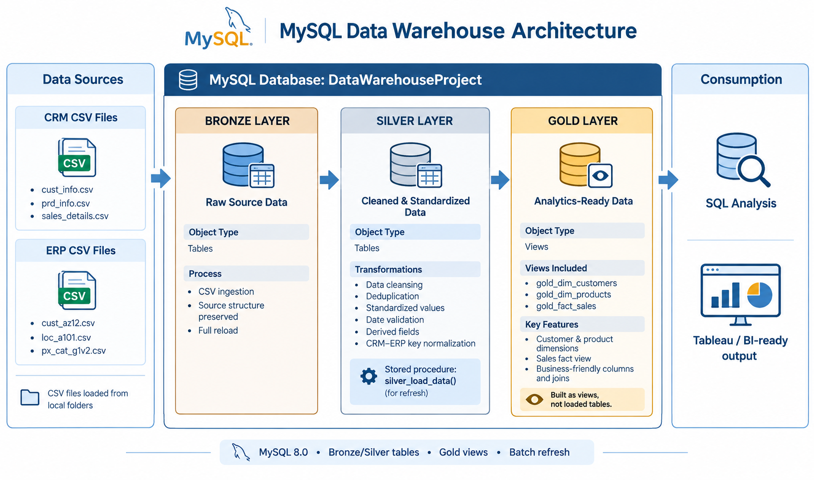

# MySQL Data Warehouse Project

## Project Overview

This project demonstrates the development of a data warehouse using **MySQL 8.0** and SQL. It integrates data from Customer Relationship Management (CRM) and Enterprise Resource Planning (ERP) systems, processes the raw data through a Bronze–Silver–Gold architecture, and prepares analytics-ready views for business analysis.

The project focuses on data ingestion, data cleansing, standardization, transformation, data integration, data quality checks, and analytical data modeling.

## Data Warehouse Architecture

The data warehouse follows a three-layer architecture:

<p align="center">
  
</p>

### Architecture Overview

| Layer | Object Type | Description |
|---|---|---|
| Bronze | Tables | Stores raw data loaded from CRM and ERP CSV files. |
| Silver | Tables | Cleans, standardizes, validates, and transforms the raw data. |
| Gold | Views | Provides integrated, business-ready data for analytical queries. |

## Data Sources

The project uses six CSV files from CRM and ERP source systems.

### CRM Sources

| File | Description |
|---|---|
| `cust_info.csv` | Customer information, including customer identifiers and demographic attributes. |
| `prd_info.csv` | Product information, including product identifiers, names, costs, and product lines. |
| `sales_details.csv` | Sales transaction details, including order dates, products, quantities, and sales amounts. |

### ERP Sources

| File | Description |
|---|---|
| `CUST_AZ12.csv` | Additional customer attributes, including birth dates and gender. |
| `LOC_A101.csv` | Customer location and country information. |
| `PX_CAT_G1V2.csv` | Product category, subcategory, and maintenance information. |

## Data Processing Workflow

### 1. Bronze Layer — Raw Data

The Bronze layer stores source data in MySQL tables using a structure close to the original CSV files.

Key activities:
- Load source data from CRM and ERP CSV files.
- Preserve the original source structure as much as practical.
- Support batch-based data loading and reloading.

### 2. Silver Layer — Cleansed and Standardized Data

The Silver layer applies SQL transformations to improve data consistency and usability.

Key activities:
- Remove duplicate customer records.
- Clean text values and standardize customer attributes.
- Normalize customer and product identifiers for integration.
- Handle missing, invalid, and inconsistent values.
- Convert date fields into appropriate date formats.
- Derive product validity end dates.
- Validate and correct sales amounts and prices where applicable.
- Standardize country and demographic values.

The `silver_load_data()` stored procedure refreshes the Silver tables from the Bronze layer.

### 3. Gold Layer — Analytics-Ready Views

The Gold layer consists of SQL views that integrate the cleaned data into business-oriented structures.

| View | Description |
|---|---|
| `gold_dim_customers` | Customer dimension containing customer details, location, demographic information, and account creation date. |
| `gold_dim_products` | Product dimension containing product details, category, subcategory, cost, product line, and start date. |
| `gold_fact_sales` | Sales fact view connecting transaction records with customer and product dimensions. |

These views support analytical SQL queries without requiring a separate data-loading process into Gold tables.

## Data Quality Checks

SQL scripts are provided to examine data quality across the Bronze and Silver layers.

The checks cover:
- Missing and duplicate identifiers.
- Inconsistent text formatting.
- Invalid or missing dates.
- Negative or missing product costs.
- Sales amount and price consistency.
- Unexpected categorical values.
- Row counts across the data warehouse layers.

These checks help identify potential data issues and validate transformation logic. Actual results depend on the source data and the execution of the scripts.

## Technology Stack

- **Database:** MySQL 8.0
- **Query Language:** SQL
- **Data Sources:** CRM and ERP CSV files
- **Data Modeling:** Bronze–Silver–Gold architecture
- **Data Transformation:** SQL queries and stored procedures
- **Analytical Layer:** SQL views

## Repository Structure

```text
sql_data_warehouse_project/
├── datasets/
│   ├── source_crm/
│   └── source_erp/
├── scripts/
│   ├── bronze/
│   ├── silver/
│   └── gold/
├── tests/
├── images/
│   └── data_warehouse_architecture.png
└── README.md
```

*Note: The structure above is illustrative. Adjust the folder names to match the actual repository structure.*

## How to Use

1. Install and configure MySQL 8.0.
2. Clone or download this repository.
3. Place the source CSV files in the appropriate folders.
4. Execute the Bronze layer scripts to create and load the raw tables.
5. Execute the Silver layer scripts and run `silver_load_data()` to process the data.
6. Create the Gold views using the provided SQL scripts.
7. Run the data quality checks and analytical queries.

Review the SQL scripts and update any file paths to match your local MySQL configuration before executing them.

## Limitations and Future Improvements

- The current workflow uses full refreshes for the Silver layer rather than incremental loading.
- Gold surrogate keys generated using `ROW_NUMBER()` may change when the underlying data or ordering changes.
- Data integration depends on consistent identifiers across CRM and ERP sources.
- Automated orchestration, logging, and error handling could be added to improve operational reliability.
- The Gold views can be connected to a BI tool for further visualization and reporting.

## Connect

- **LinkedIn:** [My LinkedIn Profile](https://www.linkedin.com/in/gist-widdan-anasis-3a0a5b39a?utm_source=share_via&utm_content=profile&utm_medium=member_android)
- **GitHub:** [My GitHub Profile](GITHUB_PROFILE_URL)
